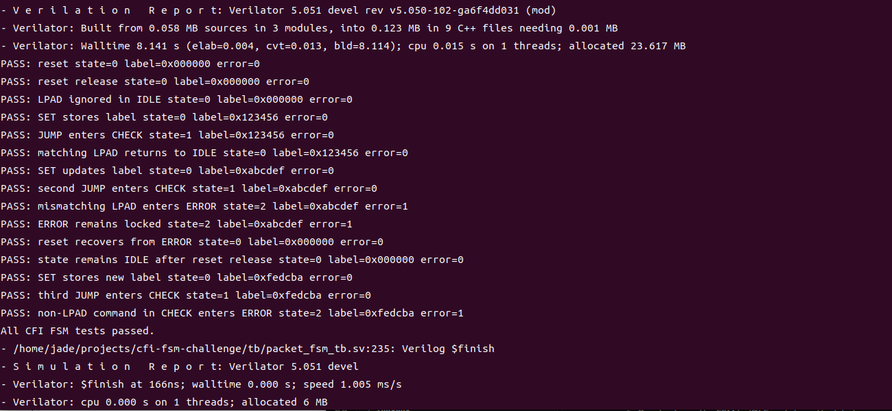
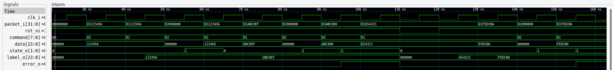

# Coding Challenge: Implementation of the RISC-V ISA Extensions for Control-Flow Integrity

## 3-State Packet FSM in SystemVerilog

**Author:** Ruijue Luo  
**Date:** August 3, 2026

---

## 1. Objective

The objective of this challenge is to implement a three-state finite-state machine in SystemVerilog. The FSM accepts one 32-bit packet per clock cycle.

Each packet contains:

- An 8-bit command in `packet_i[31:24]`
- A 24-bit data field in `packet_i[23:0]`

The supported commands are:

| Command | Value | Function |
|---|---:|---|
| SET | `8'h01` | Store the data field in the internal label register |
| JUMP | `8'h02` | Enter the CHECK state |
| LPAD | `8'h03` | Check the data field against the stored label |

The design represents a simplified control-flow integrity mechanism. A jump is accepted only when it is followed by a landing-pad packet containing the expected label.

---

## 2. Functional Behaviour

The FSM contains three states:

- `IDLE`: normal operation and label configuration
- `CHECK`: verification of the packet following a JUMP
- `ERROR`: permanent error state until reset

The state transitions are shown below.

| Current state | Input condition | Operation | Next state |
|---|---|---|---|
| IDLE | SET | Store packet data as label | IDLE |
| IDLE | JUMP | Start landing-pad check | CHECK |
| IDLE | Other command | No operation | IDLE |
| CHECK | LPAD and data matches label | Check passes | IDLE |
| CHECK | Any other condition | Check fails | ERROR |
| ERROR | Any packet | No operation | ERROR |

The ERROR state is sticky. Once it is reached, the FSM remains in ERROR until reset is asserted.

---

## 3. Interface

The implemented module uses the following interface.

| Signal | Direction | Width | Description |
|---|---|---:|---|
| `clk_i` | Input | 1 | Clock |
| `rst_ni` | Input | 1 | Active-low asynchronous reset |
| `packet_i` | Input | 32 | Command and data packet |
| `state_o` | Output | 2 | Current FSM state |
| `label_o` | Output | 24 | Stored label |
| `error_o` | Output | 1 | High when the FSM is in ERROR |

The state encoding is:

| State | Encoding |
|---|---:|
| IDLE | `2'b00` |
| CHECK | `2'b01` |
| ERROR | `2'b10` |

The state and label outputs are included to make the internal behaviour observable during verification.

---

## 4. RTL Implementation

The implementation separates combinational next-state logic from sequential state and label registers.

```systemverilog
`timescale 1ns/1ps

module packet_fsm (
  input  logic        clk_i,
  input  logic        rst_ni,
  input  logic [31:0] packet_i,

  output logic [1:0]  state_o,
  output logic [23:0] label_o,
  output logic        error_o
);

  localparam logic [7:0] CMD_SET  = 8'h01;
  localparam logic [7:0] CMD_JUMP = 8'h02;
  localparam logic [7:0] CMD_LPAD = 8'h03;

  typedef enum logic [1:0] {
    IDLE  = 2'b00,
    CHECK = 2'b01,
    ERROR = 2'b10
  } state_e;

  state_e state_q;
  state_e state_d;

  logic [23:0] label_q;
  logic [7:0]  command;
  logic [23:0] data;

  assign command = packet_i[31:24];
  assign data    = packet_i[23:0];

  always_comb begin
    state_d = state_q;

    unique case (state_q)
      IDLE: begin
        if (command == CMD_JUMP) begin
          state_d = CHECK;
        end
      end

      CHECK: begin
        if ((command == CMD_LPAD) && (data == label_q)) begin
          state_d = IDLE;
        end else begin
          state_d = ERROR;
        end
      end

      ERROR: begin
        state_d = ERROR;
      end

      default: begin
        state_d = ERROR;
      end
    endcase
  end

  always_ff @(posedge clk_i or negedge rst_ni) begin
    if (!rst_ni) begin
      state_q <= IDLE;
      label_q <= 24'h000000;
    end else begin
      state_q <= state_d;

      if ((state_q == IDLE) && (command == CMD_SET)) begin
        label_q <= data;
      end
    end
  end

  assign state_o = state_q;
  assign label_o = label_q;
  assign error_o = (state_q == ERROR);

endmodule : packet_fsm
```

### Design decisions

The active-low reset initializes the state to IDLE and clears the label register.

The label register is updated only when a SET command is received in the IDLE state. A SET command received in CHECK or ERROR cannot modify the stored label.

In CHECK, the FSM returns to IDLE only when both conditions are true:

```systemverilog
command == CMD_LPAD
data == label_q
```

Every other condition causes the FSM to enter ERROR.

---

## 5. Verification Strategy

A self-checking SystemVerilog testbench was developed to verify the required behaviour.

The following scenarios are covered:

| Test | Expected result |
|---|---|
| Reset | State becomes IDLE and label is cleared |
| LPAD in IDLE | Packet is ignored |
| SET in IDLE | Data is stored in the label register |
| JUMP in IDLE | FSM enters CHECK |
| Matching LPAD in CHECK | FSM returns to IDLE |
| Mismatching LPAD in CHECK | FSM enters ERROR |
| Non-LPAD command in CHECK | FSM enters ERROR |
| Command in ERROR | FSM remains in ERROR |
| Reset in ERROR | FSM returns to IDLE |

The testbench checks the state, stored label, and error output after each test. A mismatch terminates the simulation using `$fatal`.

---

## 6. Testbench
```
`timescale 1ns/1ps

module packet_fsm_tb;

  localparam logic [7:0] CMD_SET  = 8'h01;
  localparam logic [7:0] CMD_JUMP = 8'h02;
  localparam logic [7:0] CMD_LPAD = 8'h03;

  localparam logic [1:0] STATE_IDLE  = 2'b00;
  localparam logic [1:0] STATE_CHECK = 2'b01;
  localparam logic [1:0] STATE_ERROR = 2'b10;

  logic        clk_i;
  logic        rst_ni;
  logic [31:0] packet_i;

  logic [1:0]  state_o;
  logic [23:0] label_o;
  logic        error_o;

  packet_fsm dut (
    .clk_i    (clk_i),
    .rst_ni   (rst_ni),
    .packet_i (packet_i),
    .state_o  (state_o),
    .label_o  (label_o),
    .error_o  (error_o)
  );

  initial begin
    clk_i = 1'b0;
    forever #5 clk_i = ~clk_i;
  end

  task automatic send_packet(
    input logic [7:0]  command,
    input logic [23:0] data
  );
    begin
      @(negedge clk_i);
      packet_i = {command, data};

      @(posedge clk_i);
      #1;
    end
  endtask

  task automatic check_outputs(
    input logic [1:0]  expected_state,
    input logic [23:0] expected_label,
    input logic        expected_error,
    input string       test_name
  );
    begin
      if ((state_o !== expected_state) ||
          (label_o !== expected_label) ||
          (error_o !== expected_error)) begin
        $fatal(
          1,
          "FAIL: %s state=%0d label=0x%06h error=%0b",
          test_name,
          state_o,
          label_o,
          error_o
        );
      end

      $display(
        "PASS: %s state=%0d label=0x%06h error=%0b",
        test_name,
        state_o,
        label_o,
        error_o
      );
    end
  endtask

  initial begin
    $dumpfile("build/packet_fsm_tb.vcd");
    $dumpvars(0, packet_fsm_tb);

    rst_ni   = 1'b0;
    packet_i = 32'h00000000;

    repeat (2) @(posedge clk_i);
    #1;

    check_outputs(
      STATE_IDLE,
      24'h000000,
      1'b0,
      "reset"
    );

    @(negedge clk_i);
    rst_ni = 1'b1;

    @(posedge clk_i);
    #1;

    check_outputs(
      STATE_IDLE,
      24'h000000,
      1'b0,
      "reset release"
    );

    // LPAD in IDLE must not change the state.
    send_packet(CMD_LPAD, 24'h123456);
    check_outputs(
      STATE_IDLE,
      24'h000000,
      1'b0,
      "LPAD ignored in IDLE"
    );

    // SET stores the label while remaining in IDLE.
    send_packet(CMD_SET, 24'h123456);
    check_outputs(
      STATE_IDLE,
      24'h123456,
      1'b0,
      "SET stores label"
    );

    // Correct JUMP -> LPAD sequence.
    send_packet(CMD_JUMP, 24'h000000);
    check_outputs(
      STATE_CHECK,
      24'h123456,
      1'b0,
      "JUMP enters CHECK"
    );

    send_packet(CMD_LPAD, 24'h123456);
    check_outputs(
      STATE_IDLE,
      24'h123456,
      1'b0,
      "matching LPAD returns to IDLE"
    );

    // A mismatching LPAD must enter ERROR.
    send_packet(CMD_SET, 24'hABCDEF);
    check_outputs(
      STATE_IDLE,
      24'hABCDEF,
      1'b0,
      "SET updates label"
    );

    send_packet(CMD_JUMP, 24'h000000);
    check_outputs(
      STATE_CHECK,
      24'hABCDEF,
      1'b0,
      "second JUMP enters CHECK"
    );

    send_packet(CMD_LPAD, 24'hABC000);
    check_outputs(
      STATE_ERROR,
      24'hABCDEF,
      1'b1,
      "mismatching LPAD enters ERROR"
    );

    // ERROR must remain active and the label must not change.
    send_packet(CMD_SET, 24'h654321);
    check_outputs(
      STATE_ERROR,
      24'hABCDEF,
      1'b1,
      "ERROR remains locked"
    );

    // Reset must recover from ERROR.
    // Clear packet_i to prevent the previous SET packet from being
    // accepted again after reset is released.
    @(negedge clk_i);
    rst_ni   = 1'b0;
    packet_i = 32'h00000000;

    @(posedge clk_i);
    #1;

    check_outputs(
      STATE_IDLE,
      24'h000000,
      1'b0,
      "reset recovers from ERROR"
    );

    @(negedge clk_i);
    rst_ni = 1'b1;

    @(posedge clk_i);
    #1;

    check_outputs(
      STATE_IDLE,
      24'h000000,
      1'b0,
      "state remains IDLE after reset release"
    );

    // Any non-LPAD command in CHECK must enter ERROR.
    send_packet(CMD_SET, 24'hFEDCBA);
    check_outputs(
      STATE_IDLE,
      24'hFEDCBA,
      1'b0,
      "SET stores new label"
    );

    send_packet(CMD_JUMP, 24'h000000);
    check_outputs(
      STATE_CHECK,
      24'hFEDCBA,
      1'b0,
      "third JUMP enters CHECK"
    );

    send_packet(CMD_SET, 24'hFEDCBA);
    check_outputs(
      STATE_ERROR,
      24'hFEDCBA,
      1'b1,
      "non-LPAD command in CHECK enters ERROR"
    );

    $display("All CFI FSM tests passed.");

    #10;
    $finish;
  end

endmodule : packet_fsm_tb
```

---

## 7. Simulation Script

File:

```text
scripts/run_verilator.sh
```

```bash
#!/usr/bin/env bash

set -euo pipefail

PROJECT_ROOT="$(cd "$(dirname "${BASH_SOURCE[0]}")/.." && pwd)"
BUILD_DIR="${PROJECT_ROOT}/build"

if ! command -v verilator >/dev/null 2>&1; then
  echo "Error: verilator was not found in PATH." >&2
  echo "Run: source ~/tools/oss-cad-suite/environment" >&2
  exit 1
fi

mkdir -p "${BUILD_DIR}"
cd "${PROJECT_ROOT}"

verilator \
  --binary \
  --timing \
  --trace \
  -Wall \
  -Wno-BLKSEQ \
  --top-module packet_fsm_tb \
  --Mdir "${BUILD_DIR}/obj_dir" \
  "${PROJECT_ROOT}/rtl/packet_fsm.sv" \
  "${PROJECT_ROOT}/tb/packet_fsm_tb.sv"

"${BUILD_DIR}/obj_dir/Vpacket_fsm_tb"
```

The script performs the following steps:

1. Determines the project root directory.
2. Checks that Verilator is available.
3. Creates the build directory.
4. Compiles the RTL and testbench.
5. Builds the simulation executable.
6. Runs the self-checking testbench.
7. Generates the VCD waveform.

---

## 8. Makefile

File:

```text
Makefile
```

```makefile
.PHONY: test wave clean

test:
	./scripts/run_verilator.sh

wave:
	gtkwave build/packet_fsm_tb.vcd

clean:
	rm -rf build
```

The complete simulation can be run with:

```bash
make clean
make test
```

The generated waveform can be opened with:

```bash
make wave
```

---

## 9. Simulation Results

The self-checking testbench verifies both successful and unsuccessful control-flow checks.

A successful simulation ends with:

```text
All CFI FSM tests passed.
```

The terminal output from the completed simulation is shown below.



---

## 10. Waveform Analysis

The waveform should contain the following signals:

1. A SET packet stores its data field in `label_o`.
2. A JUMP packet changes `state_o` from IDLE to CHECK.
3. A matching LPAD packet changes `state_o` from CHECK to IDLE.
4. A mismatching LPAD packet changes `state_o` from CHECK to ERROR.
5. Once ERROR is reached, `error_o` remains high until reset.
6. Reset returns the FSM to IDLE and clears the label.



---

## 11. Project Structure

```text
cfi-fsm-challenge/
├── images/
│   ├── simulation_output.png
│   └── fsm_waveform.png
├── rtl/
│   └── packet_fsm.sv
├── scripts/
│   └── run_verilator.sh
├── tb/
│   └── packet_fsm_tb.sv
├── Makefile
├── README.md
└── report.md
```

